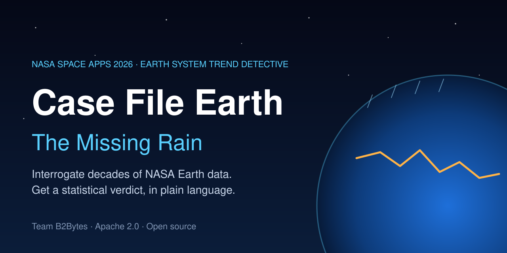

<p align="center">
  
</p>

<p align="center">
  
  
  
  
</p>

# Case File Earth: The Missing Rain

**Anyone can interrogate decades of NASA Earth data and get a statistical verdict on what is really changing.**

Built by Team B2Bytes for the NASA Space Apps Challenge 2026 (Universal Event), challenge *Be An Earth System Trend Detective!*

> Status, stated plainly: this repository was created on 14 Nov 2026, during the hackathon. The sections below describe the scope we are building. Everything is marked **Planned** until the code is in this repo. Nothing here is claimed as finished before it is.

*Resumen en español al final.*

---

## The story

Ask anyone in central Chile whether it rains less than it used to. Most will say yes. Ask for proof and you get headlines, opinions and one wet winter that changes the conversation.

Earth observation has the answer. Decades of satellite and model data exist, free and open. But a student, a farmer or a town council cannot easily go from "NASA has this data" to "is my place changing, by how much, and can we trust that number?"

**Case File Earth turns that question into an investigation.**

1. **Open a case.** Pick a place you care about and a suspicion: is it raining less, getting hotter, drying out?
2. **Interrogate the data.** The tool pulls a long monthly record for that exact spot from NASA data.
3. **Review the evidence.** A time series, with the seasonal cycle removed, so the real signal is visible.
4. **Get the verdict.** Rate of change per decade, and a plain-language ruling: *strong evidence*, *weak evidence* or *trend not proven*. Saying "we cannot tell yet" is a valid finding, and the tool says it honestly.

### The flagship case: "The Missing Rain"

Central Chile has lived through a long dry spell that people call a mega-drought. It is local, it is measurable, and the same pattern matters in other Mediterranean-type regions around the world. The first case file asks one question of NASA precipitation data for the Santiago and Valparaiso area: **is the rain really missing, and is the change statistically significant?**

We do not state the answer here. The tool computes it, from the data, in the open. Whatever the verdict is, that is what we publish.

---

## What it does (Features)

Status key: **Built** = in this repo and working. **Planned** = in scope for the hackathon deadline, not built yet. **Later** = idea, not committed.

| Feature | Status |
|---|---|
| Case-file flow: place, suspicion, start year, in a few short questions | Planned |
| Monthly time series for a chosen point from the NASA POWER API (no API key) | Planned |
| Variables: precipitation (`PRECTOTCORR`), temperature (`T2M`), humidity (`QV2M`), wind (`WS10M`) | Planned |
| Seasonal cycle removed (monthly anomalies) before testing | Planned |
| Trend tests: linear fit with t-test and 95% confidence interval, Mann-Kendall with Sen's slope | Planned |
| Plain-language verdict card, with a one-line definition of each variable | Planned |
| Two preloaded demo cases: "The Missing Rain" (central Chile) and a temperature case | Planned |
| Frozen offline copy of the demo data, so demos work if an API is down | Planned |
| CSV download of the evidence | Planned |
| Methods and sources page, including the declaration of AI use | Planned |
| English interface, Spanish and English subtitles on the demo video | Planned |

### Roadmap (nothing below is promised for the hackathon)

- **Later:** more regions and variables, vegetation and soil moisture from other NASA products.
- **Later:** a shareable link to any case file.
- **Later:** a classroom mode with guided questions.

---

## How it works (design)

```
 place + suspicion  ->  NASA POWER monthly series  ->  monthly anomalies
        ->  trend tests (Mann-Kendall, Sen's slope, OLS + t-test + 95% CI)
        ->  verdict in plain language  ->  evidence you can download
```

Verdict rule we plan to use (documented in the app so anyone can challenge it):

- p < 0.05: **strong evidence** of a trend
- 0.05 to 0.15: **weak evidence**, trend not proven
- otherwise: **no proven trend**

Limits we will state in the app:

- Linear trends only. A real system can change in other shapes.
- A point value is not a whole region.
- A short record weakens any trend test. More years, stronger evidence.
- A significant trend shows that something changed, not why.

---

## Data and sources

- **NASA POWER** (Prediction Of Worldwide Energy Resources, NASA Langley Research Center), monthly point API. Docs: https://power.larc.nasa.gov/docs/
- **Challenge statement and resources:** https://www.spaceappschallenge.org/ (challenge *Be An Earth System Trend Detective!*)
- Possible cross-checks, only if they are used and cited in the final submission: NASA Giovanni and GPM IMERG via GES DISC.

Every source used in the final build will be listed here and in the submission References.

---

## Use of AI (declared)

We use AI tools to speed up code, copy and review of the statistical code. The team sets the concept, chooses the data and checks the science. Any AI-generated image carries a visible watermark. No NASA logos or branding are used.

---

## Learn along

We keep a public log of what we learn during the hackathon in [LEARNING.md](LEARNING.md): what worked, what the data showed, what we got wrong and fixed.

---

## License

Apache License 2.0. See [LICENSE](LICENSE). This project is open source and free to use.

---

## Resumen en español

**Case File Earth: El caso de la lluvia perdida.** Una herramienta abierta donde cualquier persona abre un "caso" sobre su lugar del planeta, la herramienta consulta décadas de datos de la NASA (API NASA POWER) y entrega un veredicto estadístico en lenguaje simple: cuánto cambió, y si el cambio es significativo (Mann-Kendall, pendiente de Sen, t-test con intervalo de confianza). El caso insignia es la sequía prolongada de Chile central. Hecho por el equipo B2Bytes para NASA Space Apps 2026, reto *Earth System Trend Detective*. Estado: en desarrollo; todo lo descrito está marcado como "Planned" hasta que el código esté en este repositorio.
